<p align="center">
  
</p>

# Airlock

**The best AI, without giving yourself away.**

Airlock lets people get help from frontier cloud AI with their most private material — a tense text thread with a landlord, a lease clause, a hospital bill, an HR complaint, a message that might be a scam — while the details that identify them stay on their own device.

A small model you own (the on-device model, through **Firebase AI Logic hybrid inference**) supervises a big model you rent (**Gemini** in the cloud). Raw text is only ever read on the device; Gemini only ever receives sealed text; the real details come back into the answer locally; and every request leaves a tamper-evident receipt.

Built for **#BuildHybridAI 2026** — on **iPhone & Mac**, the **web**, and **Android**, from one privacy engine.

| Try it | |
|---|---|
| **Web** (desktop Chrome with built-in AI) | **https://airlock-hybrid-dev-f1bb0.web.app** — add `?demo=1` for a scripted tour that makes no AI calls |
| **Android** | Build the APK from source (below) — a signed APK is attached to the GitHub release at submission. Gemini Nano on supported phones; rules + review elsewhere |
| **iPhone & Mac** | Build from source (below); runs in the iOS Simulator and as a Mac app |

---

## How it works

<p align="center"></p>

1. **Detect** — your Vault (names you always protect), pattern rules (phones, emails, IDs, cards, one-time codes) and the on-device model (people, places, employers, health details) find what identifies you.
2. **Seal** — each detail becomes a placeholder such as `[[PERSON_1]]`, or something general such as "a large hospital".
3. **Red-team** — the device attacks its own draft ("what could a stranger still guess?") and suggests safer wording.
4. **Gate** — seven deterministic checks are the *only* way to produce `SealedText`, the only type a cloud engine accepts. It fails closed.
5. **You review** exactly what will leave. Tap a chip to send a detail as written, or **Protect this** to seal something the detectors missed.
6. **Gemini answers** the sealed request. **Restore** puts the real details back, locally, while the answer streams.
7. **Receipt** — a SHA-256 of exactly what left, chained to the previous receipt, so the history can't be quietly edited.

Quick tasks (summaries, rewrites, explanations) can be answered by the on-device model itself — then nothing leaves at all. Without an on-device model, Airlock falls back to rules plus mandatory review, **never** to sending raw text.

## Architecture

<p align="center"></p>

- **One engine, three languages.** `Packages/AirlockKit` (Swift), `web/src/engine` (TypeScript) and `android/core` (Kotlin) implement the same pipeline. All three must pass the same fixtures in [`spec/fixtures/`](spec/fixtures) byte-for-byte; the Kotlin port was additionally checked against TypeScript on ~50,000 random inputs.
- **Hybrid inference everywhere.** Apple Foundation Models (iOS/macOS, `firebase-ios-sdk` 12.19.0), Chrome's built-in Gemini Nano (web, `firebase` 13.3.0) and Gemini Nano via ML Kit / AICore (Android, `firebase-ai` 18.2.0 + `firebase-ai-ondevice`), each with Gemini in the cloud — all through Firebase AI Logic.
- **Cloud answers degrade gracefully.** A first-chunk guard and a model fallback chain (planned model → stable fallback → one unary call) keep answers coming when a model is overloaded; the badge always names the model that actually answered.

## Privacy invariants (enforced in code, not just promised)

| | Guarantee | How it's enforced |
|---|---|---|
| INV-1 | Raw text never reaches a cloud model, Firestore, logs or analytics | Cloud engines accept only `SealedText`; lint + tests |
| INV-2 | `SealedText` can only come from the egress gate | Swift SPI init, TS brand, Kotlin `GateToken`; source-scanning tests on every platform |
| INV-3 | Raw text is only processed on-device | `PhoneOnlyEngine` is the only engine that takes raw text (`ONLY_ON_DEVICE`) |
| INV-6 | The placeholder ↔ real-name map never leaves the device | AES-256-GCM with a Keychain / Keystore / non-extractable WebCrypto key |
| INV-7 | Restored answers are never synced | The optional backup holds only what already went to Gemini — property-tested |
| INV-9 | No on-device model → rules + review, never the cloud | Pipeline tests on all platforms |

Full list: [`AGENTS.md`](AGENTS.md) §2.

## Evidence

- **Tests:** Swift package (155), web (259), Kotlin core (80) + Android app (48), Firestore rules & Cloud Functions in the emulator (14), benchmark scorer (34) — all in CI on every push.
- **Conformance:** one fixture suite, three implementations, byte-identical placeholders, legends and hash chains.
- **Benchmark:** AirlockBench (`eval/`) measures leak rate, over-redaction and answer utility. Published numbers come only from the final run on the evaluation project — never from mock runs. The web, iPhone/Mac and Android apps show the latest report under **Settings → How Airlock is tested** (tiles with 95% intervals and a per-layer leak-rate chart); until the final run, it shows the mock report under a "MOCK RUN" banner.

---

## Where Firebase AI Logic is used (for judges)

This table is kept current by agents (see `AGENTS.md` §10). Paths point to real code.

Firebase AI Logic iOS SDK **12.19.0** (the release with the documented `HybridModel` API — see `docs/API-NOTES.md` §7). Every call goes through `Packages/AirlockKit/Sources/AirlockEngines/`, the only module that imports `FirebaseAILogic`.

| Capability | Inference mode | Firebase AI Logic call | File |
|-----------|----------------|------------------------|------|
| Entity detection on raw text (`detect.v1`; `detect.v2` when Remote Config `detect_prompt_id` says so) | On-device only | `generativeModelSession(model: .systemModel(guardrails: .permissiveContentTransformations))` | `AirlockEngines/FirebaseEngines.swift` (`FirebasePhoneEngine`), used by `AirlockDetect/LLMDetector.swift` |
| Generalising phrases on raw text (`gen.v1`) | On-device only | same phone-only session | `AirlockSeal/SealPipeline.swift` |
| Red-team attack (`attack.v1`) | On-device only | same phone-only session | `AirlockSeal/RedTeam.swift` *(next WP)* |
| Quick tasks on sealed text | On-device first, cloud fallback | `.hybridModel(primary: .systemModel(), secondary: .geminiModel(...))` | `AirlockEngines/ModelPlan.swift`, `FirebaseEngines.swift` (`FirebaseSealedEngine`) |
| Deep answers on sealed text (streaming) | Cloud first, on-device fallback | `.hybridModel(primary: .geminiModel(...), secondary: .systemModel())`, `streamResponse` | same |
| Private tools (function calling) | Cloud only | `generativeModel(modelName:tools: [.functionDeclarations])` + `Chat` | `AirlockEngines/ToolAndSearchEngines.swift` (`FirebaseToolEngine`) |
| Fact check with Google Search | Cloud only | `generativeModel(modelName:tools: [.googleSearch()])` | `AirlockEngines/ToolAndSearchEngines.swift` (`FirebaseSearchEngine`) |
| Conversation titles from the **sealed** first message (`title.v1`) | On-device only | same phone-only session | `AirlockRoute/ThreadTitler.swift`, called from `App/Features/Session/AirlockSession.swift` |
| "What could Gemini still guess?" (`infer.v1`) on the sealed text that already left, with a receipt | Cloud only | `generativeModelSession(model: .geminiModel(...))`, `respond` (route `cloudOnly`) | `AirlockRoute/CloudInference.swift`, called from `App/Features/Session/AirlockSession.swift` (`inferGuesses`) |
| Which model answered | — | `response.rawResponse.modelVersion` | `AirlockCore/Route.swift` (`EngineResult.ranOnDevice`) |
| Phone model availability | — | `FirebaseAI.SystemLanguageModel.default.availability` | `AirlockEngines/ErrorMapper.swift` |

The iOS/macOS app (`App/`) never calls Firebase AI Logic directly: `App/Services/AppServices.swift` creates `FirebaseEngines` (live) or scripted demo engines (`-demo`, the Demo scheme, or no Firebase config), and `App/Features/Session/AirlockSession.swift` drives `SealPipeline` → `EgressGate` → `AnswerService`.

**Web app** (`web/`, `firebase@13.3.0`): every call is in `web/src/ai/firebaseEngines.ts`, the only web file that imports `firebase/ai` (lint-enforced).

| Capability | Inference mode | Firebase AI Logic call | File |
|-----------|----------------|------------------------|------|
| Detection, generalising, red-team on raw text | `InferenceMode.ONLY_ON_DEVICE` (Chrome Gemini Nano) | `getGenerativeModel(ai, { mode })`, `generateContent` | `FirebasePhoneEngine` |
| Preparing Chrome's model (user click) | `ONLY_ON_DEVICE` | `initializeDeviceModel(onProgress)` | `FirebaseEngines.initializeOnDevice` |
| Quick tasks on sealed text | `PREFER_ON_DEVICE` | `generateContentStream` | `FirebaseSealedEngine` |
| Deep answers on sealed text | `PREFER_IN_CLOUD` / `ONLY_IN_CLOUD`, model fallback chain | `generateContentStream(text, { signal, timeout })`, unary last resort | `FirebaseSealedEngine.stream` |
| Private tools (function calling): today's date, a placeholder's role, free time from an imported .ics — each consented, every result through `EgressGate.sealToolResult` (INV-5) | `ONLY_IN_CLOUD` (function responses never run on device) | `getGenerativeModel(ai, { mode, inCloudParams: { tools: [{ functionDeclarations }], toolConfig: AUTO } })`, `startChat()`, `sendMessageStream`, `functionCalls()`, `FunctionResponsePart` | `FirebaseToolEngine` / `FirebaseToolChat`; loop in `web/src/engine/tools.ts` (`runToolLoop`) |
| Which side answered | — | `response.inferenceSource` (`on_device` / `in_cloud`) | `FirebaseSealedEngine` |
| Proof: scam tactics + claim extraction on the raw message | `ONLY_ON_DEVICE` (`tactics.v1`) | `generateContent` on the phone engine | `FirebasePhoneEngine`; pipeline in `web/src/engine/proof.ts` (`runProof`) |
| Proof: check each sealed claim against the web | `ONLY_IN_CLOUD` + Google Search grounding | `getGenerativeModel(ai, { mode, inCloudParams: { tools: [{ googleSearch: {} }] } })`, `candidates[0].groundingMetadata` (sources + Google's search suggestions shown unmodified) | `FirebaseClaimCheckEngine` |
| What could Gemini still guess? (F-25) | `ONLY_IN_CLOUD`, same SealedText as the original request | `generateContent` via the sealed engine (`infer.v1`) | `web/src/engine/infer.ts` |
| AirlockBench live evaluation — `synth.v1`, `judge.v1` (temperature 0), `attacker.v1`, raw **synthetic** baseline; answers reuse the rows above | `ONLY_IN_CLOUD` | `FirebaseEngines.model(...)`, `generateContent` | `web/bench/live.ts` → `firebaseEngines.ts`. **Not run yet:** live runs need the owner's permission (`--live --i-have-permission` + `AIRLOCK_BENCH_LIVE_OK=yes`); all runs so far used mock engines |

**Android app** (`android/`, Firebase BoM 35.2.0 = `firebase-ai` 18.2.0 + `firebase-ai-ondevice` 16.0.0-beta08): every call is in `android/app/src/main/kotlin/app/airlock/android/engines/` (a test fails if Firebase AI is used anywhere else).

| Capability | Inference mode | Firebase AI Logic call | File |
|-----------|----------------|------------------------|------|
| Detection, generalising, red-team, titles on raw/sealed text | `InferenceMode.ONLY_ON_DEVICE` (Gemini Nano via ML Kit / AICore), temperature 0, topK 1 | `generativeModel(..., onDeviceConfig = OnDeviceConfig(...))`, `generateContent` | `FirebaseEngines` (phone engine) |
| Model status, download, warm-up | — | `onDeviceExtension.checkStatus()`, `download()`, `warmUp()` | `FirebaseEngines` |
| Quick tasks / deep answers on sealed text | `PREFER_ON_DEVICE` / `PREFER_IN_CLOUD` / `ONLY_IN_CLOUD`, model fallback chain | `generateContentStream` with first-chunk guard, unary last resort | `HybridEngines`, `FirebaseModelCaller` |
| Which side answered | — | `GenerateContentResponse.inferenceSource` | `FirebaseModelCaller` |

**Other Firebase services** (not AI calls, listed for completeness): Remote Config (`web/src/ai/remoteConfig.ts`), App Check (reCAPTCHA v3 on web, App Attest / Play Integrity on Apple / Android), anonymous Auth, Firestore sealed-history backup (`web/src/ai/sync.ts`, rules in `firebase/firestore.rules`), Hosting, and Cloud Functions in `functions/` (`aggregateStats`, `scanSealed` — Sensitive Data Protection on already-sealed text — and `deleteUserData`).

---

---

## Quick start (developers)

```bash
git clone https://github.com/something1703/airlock && cd airlock
./scripts/test.sh     # everything that runs locally: fixtures, Swift, app builds, web, Android, emulator tests
./scripts/lint.sh     # privacy-invariant greps + secret scan
```

**Web** — Node 22.
```bash
cd web && npm ci
cp .env.example .env.local    # your Firebase web config (gitignored); without it the app runs rules-only
npm run dev                    # http://127.0.0.1:5173 — add ?demo=1 for scripted engines
```
For on-device AI use desktop Chrome with built-in AI enabled; click **Enable on-device AI** once so Chrome can download its model.

**iPhone & Mac** — Apple-silicon Mac, macOS 26+ with Apple Intelligence on, Xcode 26+, `brew install xcodegen`.
```bash
./scripts/gen.sh              # generates Airlock.xcodeproj from project.yml (never hand-edit it)
# Put your GoogleService-Info.plist in App/Resources/Firebase/dev/ (gitignored), then open the project
# and run the "Airlock (Dev)" scheme — or "Airlock (Demo)" for scripted engines.
```

**Android** — JDK 21, Android SDK command-line tools (no Android Studio needed).
```bash
cd android
# Put your google-services.json in android/app/ (gitignored)
./gradlew :core:test :app:assembleDebug
```

App Check: debug builds print a debug token on first launch — register it in the Firebase console (App Check → Manage debug tokens). Never commit it. Cloud setup: [`docs/05-FIREBASE-AND-GCP.md`](docs/05-FIREBASE-AND-GCP.md).

## Repository map

```
airlock/
├── App/                      SwiftUI app — iPhone, iPad and Mac from one target
├── Packages/AirlockKit/      Swift privacy engine: Core, Detect, Seal, Restore, Ledger, Prompts, Engines, Route, Store
├── web/                      React web app + TypeScript engine (web/src/engine) + Firebase layer (web/src/ai)
├── android/                  core/ (Kotlin engine) + app/ (Jetpack Compose)
├── spec/fixtures/            the cross-platform conformance suite
├── firebase/                 Firestore rules, Remote Config template, Hosting config
├── functions/                Cloud Functions (TypeScript) + rules/functions emulator tests
├── eval/                     AirlockBench: generator, runner, scorer, reports
└── docs/                     product, architecture, privacy engine, prompts, UI, testing, decisions
```

<details>
<summary><b>Documentation map</b></summary>

| # | File | What it covers |
|---|------|----------------|
| — | [`AGENTS.md`](AGENTS.md) | Rules for every coding agent; the non-negotiable privacy invariants |
| — | [`docs/API-NOTES.md`](docs/API-NOTES.md) | SDK facts verified in source, per platform, with versions |
| 01 | [`docs/01-PRODUCT.md`](docs/01-PRODUCT.md) | Problem, users, features, non-goals |
| 02 | [`docs/02-ARCHITECTURE.md`](docs/02-ARCHITECTURE.md) | Modules, types, routing, sequence flows |
| 03 | [`docs/03-PRIVACY-ENGINE.md`](docs/03-PRIVACY-ENGINE.md) | Detect, merge, policy, red-team, gate, restore in detail |
| 04 | [`docs/04-PROMPTS.md`](docs/04-PROMPTS.md) | Every prompt and output schema, versioned |
| 05 | [`docs/05-FIREBASE-AND-GCP.md`](docs/05-FIREBASE-AND-GCP.md) | Projects, App Check, Firestore, Remote Config, Functions, Model Armor |
| 06 | [`docs/06-UI-UX.md`](docs/06-UI-UX.md) | Design system, screens, motion, copy, accessibility |
| 07 | [`docs/07-EVALUATION.md`](docs/07-EVALUATION.md) | AirlockBench: datasets, metrics, report format |
| 08 | [`docs/08-BUILD-PLAN.md`](docs/08-BUILD-PLAN.md) | Work packages and acceptance criteria |
| 09 | [`docs/09-TESTING.md`](docs/09-TESTING.md) | Unit, property, integration, UI and accessibility tests |
| 10 | [`docs/10-SUBMISSION.md`](docs/10-SUBMISSION.md) | Devpost checklist, description, video script |
| 11 | [`docs/11-RISKS-AND-DECISIONS.md`](docs/11-RISKS-AND-DECISIONS.md) | Risks, open questions, decision log |

</details>

## Honesty statement (also shown in the app)

Airlock hides **who you are**, not **what happened**. The cloud model still sees your situation in general terms. Detection is not perfect, which is why there are several layers and a review screen, and why we publish our measured leak rate including the misses. Airlock helps people understand and prepare; it does not give legal, medical or financial advice.

## License

Apache-2.0. Built with the help of AI coding agents (Claude Code, Antigravity, Cursor) using Firebase Agent Skills; every privacy-critical file was reviewed by a human.
